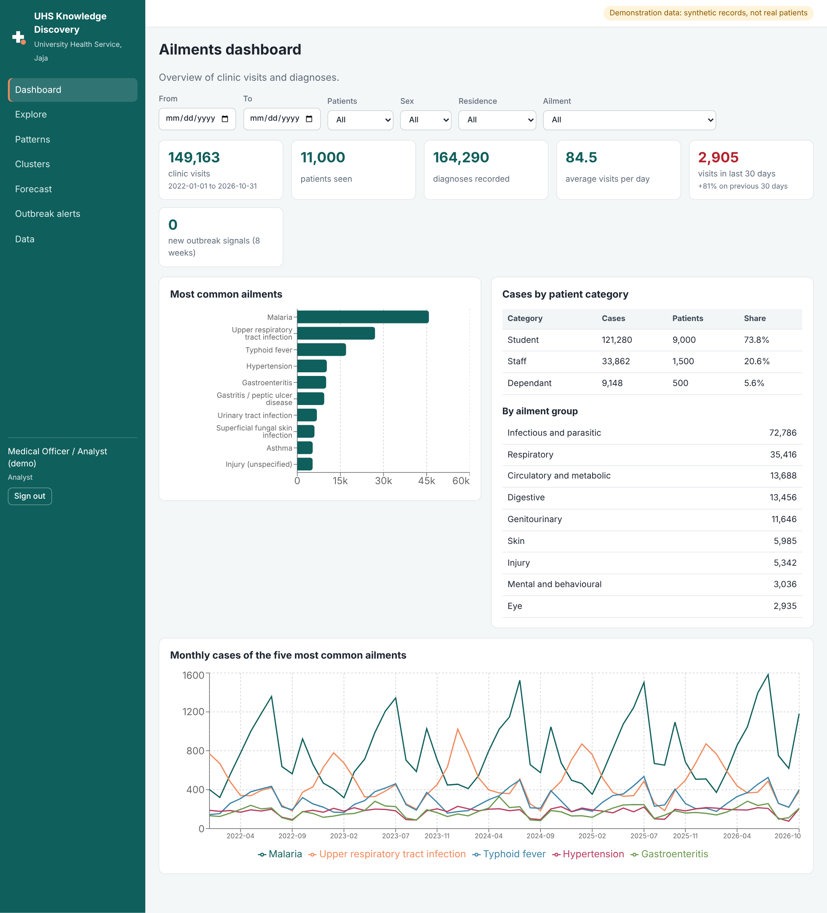
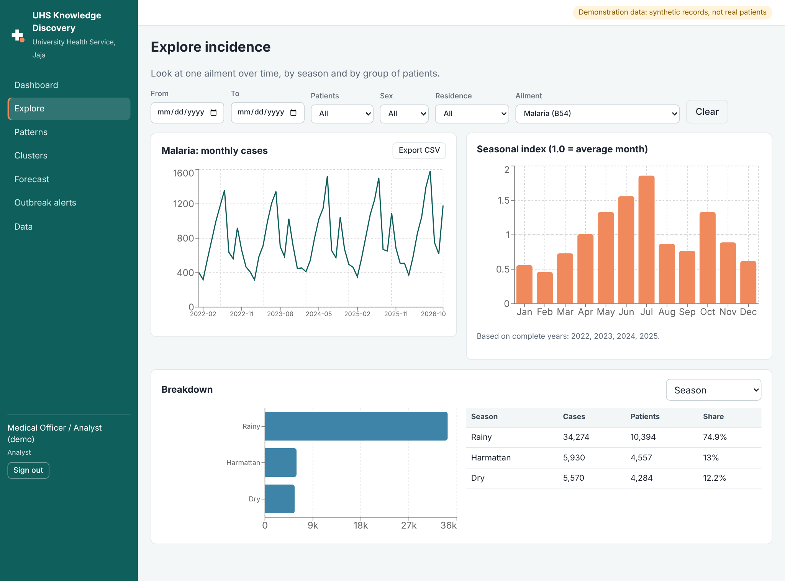
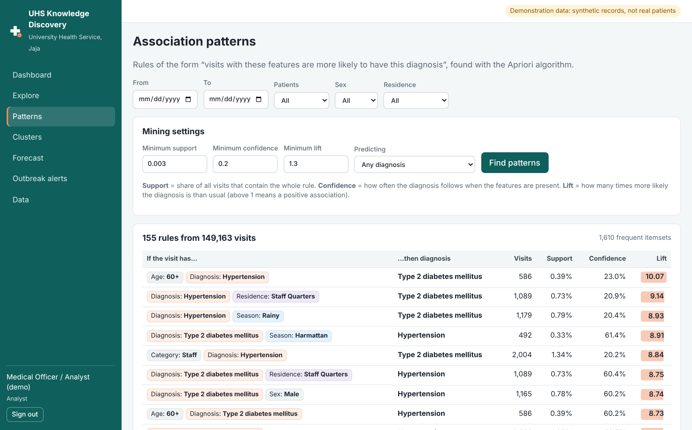
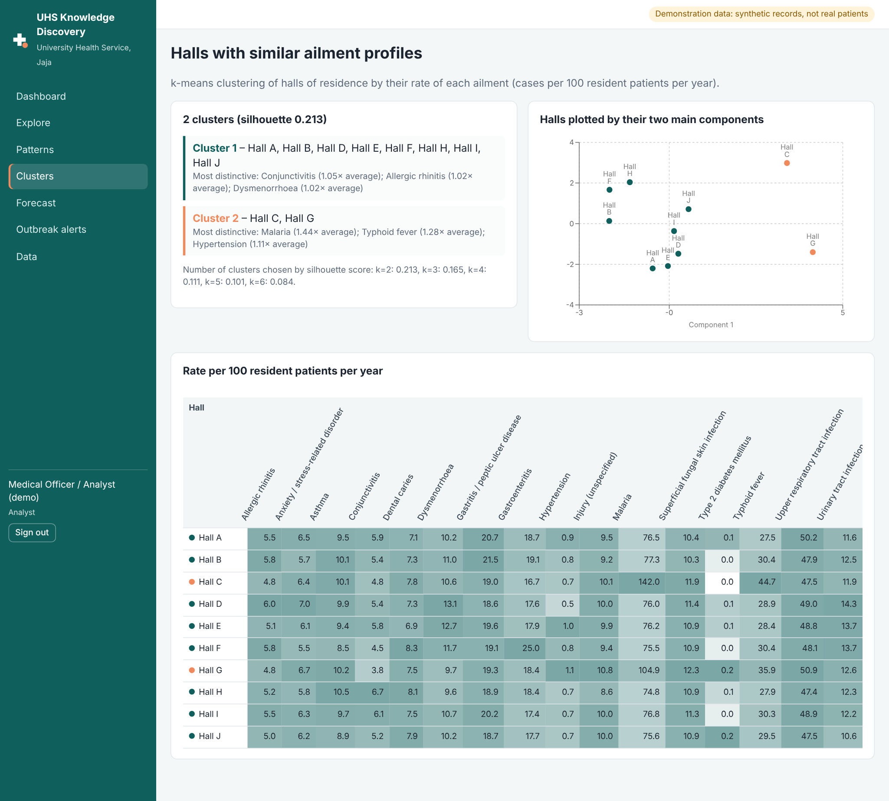
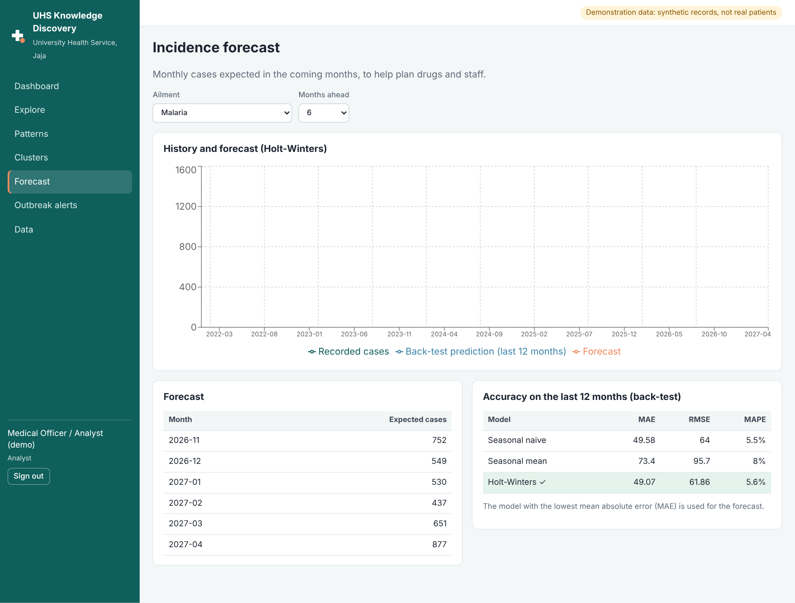
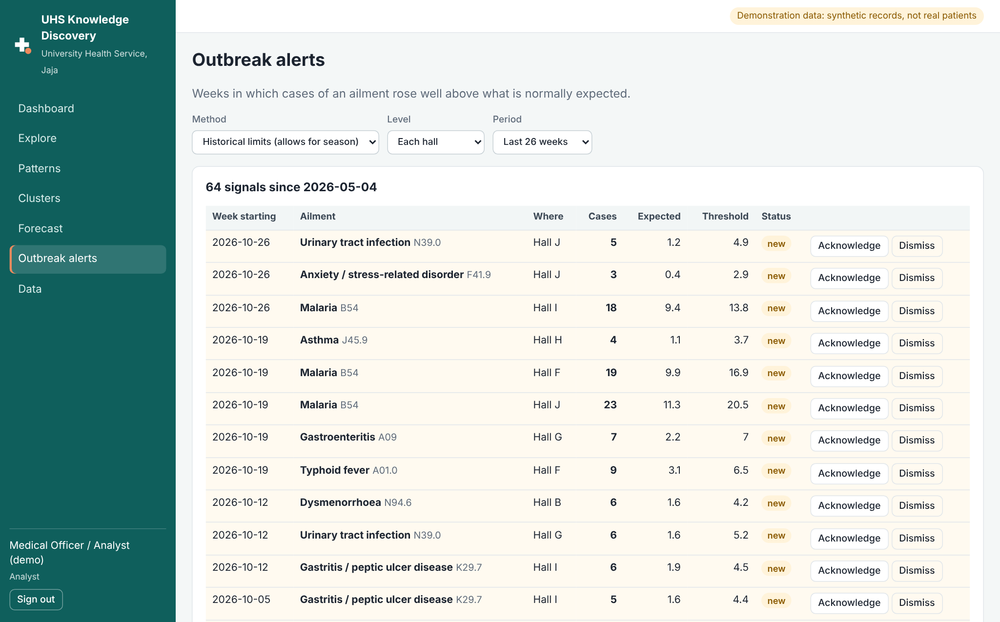

# UHS Knowledge Discovery System for Ailments Incidence

**CSC 476 Group 65 project, University of Ibadan, 2025/2026 session.**
**Case study:** University Health Service (Jaja Clinic), University of Ibadan.

This web system turns the clinic's visit and diagnosis records into knowledge that the health service can act on:

| Module | What it does | Technique |
|---|---|---|
| Data import and quality | Imports CSV exports from the medical records unit. It cleans, validates and de-duplicates the rows, then reports every issue it found. | Rule-based cleaning, HMAC-SHA256 pseudonymisation |
| Dashboard and explorer | Shows trends, seasonal patterns, and breakdowns by patient category, sex, age group, hall and season. | Aggregation (OLAP-style) |
| Association patterns | Finds rules such as *diabetes → hypertension* or *Hall C → malaria*. | Apriori (support, confidence, lift) |
| Hall clusters | Groups halls of residence with similar ailment profiles. | k-means, silhouette, PCA |
| Forecasts | Forecasts monthly incidence for drug and staff planning, with a back-test of accuracy. | Seasonal naive, seasonal mean, Holt-Winters |
| Outbreak alerts | Gives early warning of unusual weekly rises, for the whole campus or for each hall. | EARS C2, historical limits |
| Users and audit | Gives each role its own access and logs every analysis that is run. | JWT, bcrypt |

> **Note on data.** Real patient records are confidential and were not available, so the repository includes a **synthetic** dataset of 151,510 visit rows (2022–2026). It contains known, planted patterns and outbreaks, so the mining results can be checked against a ground truth. The app shows a "synthetic records" banner on every page.

## Screenshots

| | |
|---|---|
|  |  |
|  |  |
|  |  |

## Technology

- **Backend:** Python 3.11+, FastAPI, SQLAlchemy 2, pandas, scikit-learn, mlxtend, statsmodels, PyJWT, bcrypt.
- **Database:** SQLite by default. PostgreSQL works by changing `DATABASE_URL`.
- **Frontend:** React 18, Vite 5, Recharts, React Router.
- **Tests:** pytest with FastAPI TestClient (17 system tests).

## Running it locally

You need Python 3.11 or later and Node.js 18 or later.

```bash
# 1. Backend
cd backend
python -m venv .venv
# Windows: .venv\Scripts\activate     macOS/Linux: source .venv/bin/activate
pip install -r requirements.txt
cp .env.example .env                    # then edit the secrets (Windows: copy .env.example .env)

python scripts/generate_synthetic.py    # optional: the CSV is already in data/
python scripts/seed.py                  # creates the database, demo users, and imports the CSV (~10 s)
uvicorn app.main:app --reload --port 8000

# 2. Frontend (in a second terminal)
cd frontend
npm install
npm run dev                             # opens on http://localhost:5173
```

To run the system as one server, use `npm run build` in `frontend/`. FastAPI then serves the built app from `frontend/dist` at http://localhost:8000.

### Demo accounts

| Role | Username | Password | Can use |
|---|---|---|---|
| Administrator | `admin` | `Admin@12345` | Everything, including user accounts |
| Health records officer | `records` | `Records@123` | Dashboard, explorer, alerts, data import |
| Medical officer / analyst | `analyst` | `Analyst@123` | Dashboard, explorer, patterns, clusters, forecasts, alerts |

Change these passwords before using the system with real data.

## Evaluation and tests

```bash
cd backend
pytest                          # 17 tests, about 20 s
python scripts/evaluate.py      # writes data/evaluation_results.json
python scripts/benchmark.py     # API timings; the server must be running
```

The evaluation checks each technique against the patterns planted in the synthetic data (`data/ground_truth.json`):

- **Association rules:** found 5 of the 9 planted associations at the default thresholds. The four it missed have low confidence or lift.
- **Clustering:** placed the two high-malaria halls (C and G) in their own cluster.
- **Forecasting:** mean MAPE on 2025 across the eight main ailments was 8.7–9.9%, depending on the model.
- **Outbreak detection:** detected all five planted outbreaks in the test window. Historical limits gave far fewer false alarms than EARS C2 at campus level.

## Importing real clinic data

Export the records as CSV with these columns:

```
card_no, sex, birth_year, category, faculty, hall, visit_date, visit_type, diagnosis_codes
```

`diagnosis_codes` holds ICD-10 codes separated by `;`, for example `B54;A01.0`. Card numbers are replaced by a keyed pseudonym on import and are never stored.

`docs/sample_import_nov2026.csv` is a small sample file that contains some deliberate errors, so you can see the data-quality report.

## Project structure

```
backend/
  app/             FastAPI application (models, cleaning, analytics, mining, routers)
  app/mining/      associations.py, clustering.py, forecasting.py, surveillance.py
  scripts/         generate_synthetic.py, seed.py, evaluate.py, benchmark.py
  tests/           system tests
  data/            synthetic dataset, ground truth, evaluation and benchmark results
frontend/
  src/pages/       Login, Dashboard, Explore, Patterns, Clusters, Forecast, Alerts, Data, Users
docs/screenshots/  screenshots used in the report
```

## Team (Group 65)

| Name | Matric. No. | Role |
|---|---|---|
| Oluwasegun Fagbayibo | E050109 | Team Leader |
| John Ajose | E052225 | Member |
| Olanrewaju Olaniyan | E053246 | Member |
| Nicholas Mamman-Odey | E055714 | Member |

## Licence

MIT. See [LICENSE](LICENSE).
